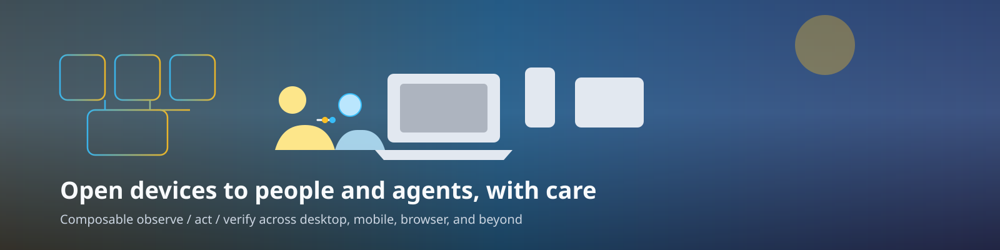

# universal_automation_ai_device_use

[](https://docs.page/arenukvern/universal_automation_ai_device_use/)
[](https://deepwiki.com/Arenukvern/universal_automation_ai_device_use)
[](https://github.com/Arenukvern/universal_automation_ai_device_use#contributors)
[](https://github.com/Arenukvern/skill_steward)
[](LICENSE)
[](https://github.com/Arenukvern/universal_automation_ai_device_use/actions/workflows/validate.yml)

**pub.dev (published packages):**  
[](https://pub.dev/packages/universal_automation_interface)
[](https://pub.dev/packages/universal_automation_toolkit)
[](https://pub.dev/packages/universal_driver_macos)
[](https://pub.dev/packages/universal_browser_cdp)
[](https://pub.dev/packages/universal_screencast)
[](https://pub.dev/packages/universal_webrtc)


<!-- banner easter-egg: squint at the SVG/PNG horizon for other curious users -->

**Make every device class legible to humans and AI agents** through one
**declarative, compositional** observe / act / verify surface — desktop and
laptop, phones and tablets, browsers, and the tiers you add next. The aim is an
**optimistic, humane** future: people and agents collaborating on real software
with **consent, receipts, and honest proof** — not unattended takeover of user
devices. Dart contracts, platform drivers, capture/WebRTC plumbing, plus an MCP
+ CLI toolkit. Lexicon packs:
[`universal_lexicon`](https://github.com/xsoulspace/dart_flutter_packages/tree/main/pkgs/universal_lexicon)
in [`dart_flutter_packages`](https://github.com/xsoulspace/dart_flutter_packages).

- 📖 **Docs:** [docs.page/arenukvern/universal_automation_ai_device_use](https://docs.page/arenukvern/universal_automation_ai_device_use/) (wiki + [DX FAQ](docs/DX_FAQ.mdx) + [llms.txt](llms.txt))
- 🤝 **Contribute:** [guide](docs/contributing/contribution_guide.mdx) · [contributors](docs/contributing/contributors.mdx) · [code of conduct](CODE_OF_CONDUCT.md) · [security](SECURITY.md)

**Charter:** [docs/NORTH_STAR.mdx](docs/NORTH_STAR.mdx) · **Decisions:** [docs/decisions/](docs/decisions/) · [AGENTS.md](AGENTS.md) · **Brand:** [docs/brand/](docs/brand/)

**Repository:** https://github.com/Arenukvern/universal_automation_ai_device_use  
**Sibling storage product:** [`universal_storage`](https://github.com/Arenukvern/universal_storage)  
**Flutter app harness (separate repo):** [`mcp_flutter`](https://github.com/Arenukvern/mcp_flutter)

- **Contribute:** [CONTRIBUTING.md](CONTRIBUTING.md) · [SECURITY.md](SECURITY.md) · [CODE_OF_CONDUCT.md](CODE_OF_CONDUCT.md)
- **Agents:** [AGENTS.md](AGENTS.md) · decisions in [docs/decisions/](docs/decisions/)

This monorepo holds the **universal automation** family: shared `AutomationDriver`
contracts, semantic projections, conformance tests, platform drivers (macOS, Linux,
Windows, CDP, WebDriver), screencast/capture helpers, and WebRTC sidecars. The
agent-facing CLI and MCP server live in
[`universal_automation_toolkit`](pkgs/universal_automation_toolkit/).

## Packages

| Package | Role |
| --- | --- |
| [`universal_automation_interface`](pkgs/universal_automation_interface/) ([pub](https://pub.dev/packages/universal_automation_interface)) | Core contracts (`Snapshot`, actions, sessions) |
| [`universal_automation_semantics`](pkgs/universal_automation_semantics/) ([pub](https://pub.dev/packages/universal_automation_semantics)) | Semantic views and family projections |
| [`universal_automation_conformance`](pkgs/universal_automation_conformance/) ([pub](https://pub.dev/packages/universal_automation_conformance)) | Shared conformance harness |
| [`universal_automation_toolkit`](pkgs/universal_automation_toolkit/) ([pub](https://pub.dev/packages/universal_automation_toolkit)) | CLI, plans, MCP server |
| `universal_driver_*` ([macOS](https://pub.dev/packages/universal_driver_macos) · [Linux](https://pub.dev/packages/universal_driver_linux) · [Windows](https://pub.dev/packages/universal_driver_windows)) | Native OS automation |
| `universal_browser_*` ([CDP](https://pub.dev/packages/universal_browser_cdp) · [WebDriver](https://pub.dev/packages/universal_browser_webdriver)) | Browser automation |
| `universal_screencast` ([pub](https://pub.dev/packages/universal_screencast)) / `universal_capture_*` ([macOS](https://pub.dev/packages/universal_capture_macos) · [Flutter](https://pub.dev/packages/universal_capture_flutter)) | Frames and capture |
| `universal_webrtc` ([pub](https://pub.dev/packages/universal_webrtc)) / `universal_webrtc_raw` ([pub](https://pub.dev/packages/universal_webrtc_raw)) | WebRTC helpers |
| [`universal_lexicon`](https://github.com/xsoulspace/dart_flutter_packages/tree/main/pkgs/universal_lexicon) | Lexicon packs ([`dart_flutter_packages`](https://github.com/xsoulspace/dart_flutter_packages), not vendored here) |
| [`universal_tooling_runtime`](pkgs/universal_tooling_runtime/) | Bounded process runs, path policy, locks, macOS no-fork verify |

Publish order and migration notes: [ADR 0001](docs/decisions/0001_drivers_into_ua_private_oss_ready.mdx).

## Quick start (toolkit + MCP)

From a clone of this repository:

```sh
./plugin/install.sh
```

That builds the AOT `universal-automation` binary and links it into
`~/.local/bin`. Point your MCP client at the bundled config in
[`plugin/mcp.json`](plugin/mcp.json) (stdio `serve --os` by default), or run
commands directly:

```sh
dart pub get
cd pkgs/universal_automation_toolkit
dart run bin/universal_automation.dart validate --plan plans/desktop-smoke.yaml
dart run bin/universal_automation.dart serve --os   # MCP stdio
```

See [`pkgs/universal_automation_toolkit/README.md`](pkgs/universal_automation_toolkit/README.md)
for plan composition, browser (`--cdp`), and consent-gated desktop flows.

## Agent plugin (Cursor / Codex / Claude / ZCode)

The shippable plugin bundle is under [`plugin/`](plugin/). After `plugin/install.sh`,
link the local plugin for Cursor:

```sh
ln -sf "$(pwd)/plugin" ~/.cursor/plugins/local/universal-automation
```

Skills are listed in [`skills.json`](skills.json); the skill body is
[`plugin/skills/universal-automation/SKILL.md`](plugin/skills/universal-automation/SKILL.md).

## Develop / validate

```sh
dart pub get
steward doctor --json   # when steward CLI is installed
steward map
# Primary gate (also runs in CI):
dart analyze pkgs/universal_automation_interface pkgs/universal_automation_semantics \
  pkgs/universal_automation_conformance pkgs/universal_browser_cdp pkgs/universal_screencast \
  pkgs/universal_webrtc_raw pkgs/universal_tooling_runtime
```

Full command list: `steward.yaml` → `stewardship.quality.validate`.

## Contributors

Thanks to everyone who improves this family.

Roster: [all-contributors](https://allcontributors.org/) · [`.all-contributorsrc`](.all-contributorsrc) · [contributors guide](docs/contributing/contributors.mdx).

<!-- ALL-CONTRIBUTORS-LIST:START - Do not remove or modify this section -->
<!-- prettier-ignore-start -->
<!-- markdownlint-disable -->
<table>
  <tbody>
    <tr>
      <td align="center" valign="top" width="14.28%"><a href="https://github.com/Arenukvern"><br /><sub><b>Anton Malofeev</b></sub></a><br /><a href="https://github.com/Arenukvern/universal_automation_ai_device_use/commits?author=Arenukvern" title="Code">💻</a> <a href="https://github.com/Arenukvern/universal_automation_ai_device_use/commits?author=Arenukvern" title="Documentation">📖</a> <a href="#infra-Arenukvern" title="Infrastructure (Hosting, Build-Tools, etc)">🚇</a> <a href="#maintenance-Arenukvern" title="Maintenance">🚧</a></td>
    </tr>
  </tbody>
</table>
<!-- markdownlint-restore -->
<!-- prettier-ignore-end -->
<!-- ALL-CONTRIBUTORS-LIST:END -->

## License

MIT — see [LICENSE](LICENSE).
